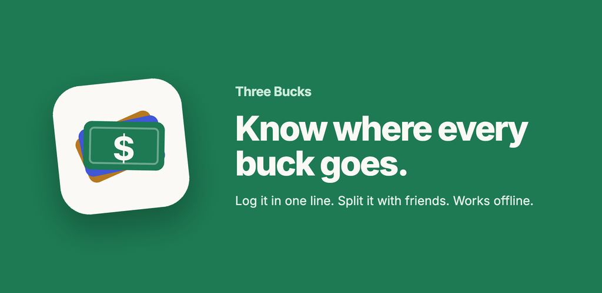

<p align="center">
  
</p>

<p align="center">
  <a href="https://play.google.com/store/apps/details?id=com.wml.threebucks"></a>
  
  <a href="LICENSE"></a>
</p>

# Three Bucks

A simple, offline-first expense tracker built with Flutter. Log an expense in one line, split it
with friends, and see what you spent, saved and earned each month.

[Website](https://www.widgetmedialabs.com/three-bucks) ·
[Privacy policy](https://www.widgetmedialabs.com/three-bucks/privacy) ·
[Changelog](CHANGELOG.md)

## Features

- **One-line entry.** Type `costco 46 split` and the amount, the split and the category are
  filled in.
- **Spent, saved, earned.** Saved is what you earned minus what you spent. Investing never counts
  as spending; it shows where your savings went.
- **Split bills.** With friends on the app, or with anyone by name. Balances, settling up, and
  flagging a share that looks wrong.
- **Budget pace.** What's safe to spend today for the rest of the month.
- **Every year, every month.** Totals, charts and entries for any month you've tracked.
- **Works offline.** Everything is stored on the device first and backed up when you sign in.
- **Your data, your way.** Import a spreadsheet (.xlsx or .csv), export any year, and keep your
  own categories.

## Getting started

You need [Flutter](https://docs.flutter.dev/get-started/install) (stable channel).

```bash
git clone https://github.com/maheshj01/three_bucks.git
cd three_bucks
flutter pub get
flutter run
```

Without Firebase set up, the app runs in local-only mode: everything works, nothing is synced.
To set up sync, sign-in and the backend, see [docs/development.md](docs/development.md).

## Documentation

- [Development guide](docs/development.md): architecture, offline sync, backend setup, tooling
  and store screenshots
- [Onboarding](docs/onboarding.md): the first-run flow

## Contributing

Issues and pull requests are welcome. Before opening a pull request, run:

```bash
flutter analyze
flutter test
```

and add a line to [CHANGELOG.md](CHANGELOG.md) under the unreleased version for anything users
will notice.

## License

[MIT](LICENSE) © Mahesh Jamdade
