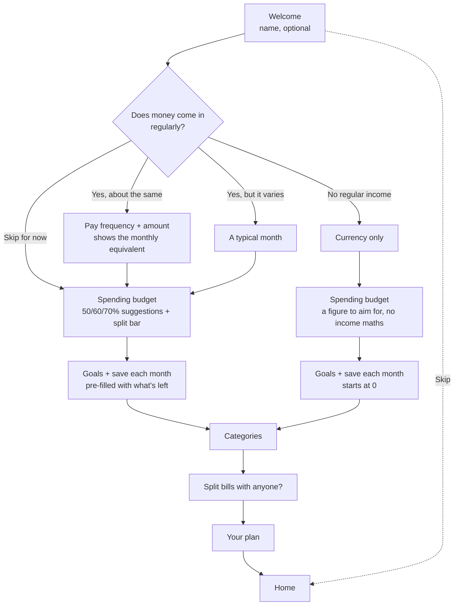

# Onboarding

The first-run setup. It asks a few questions, turns the answers into a monthly plan and a set of
spending categories, and then drops the user on Home. Anyone can skip it, and everything it sets
can be changed later from **Settings → Plan & goals**, which reopens the same flow.

Code: [`lib/features/onboarding/`](../lib/features/onboarding/)

## The three buckets

Everything in the app sorts money into three buckets. Onboarding introduces them, and the plan
screen fills them in.

| Bucket | What it holds | Category kind | Colour token |
|---|---|---|---|
| **Spent** | Groceries, rent, bills, fun: everything except savings. Counts against the budget. | `spending` | `lived` |
| **Saved** | A savings account, an emergency fund or investments. Not counted as spending. | `investing` | `invested` |
| **Earned** | Salary, pension, allowance, gifts: money coming in. | `income` | `earned` |

The data fields and colour tokens still use the original names (`livedCents`, `investedCents`,
`c.lived`, `c.invested`). Only the words people see changed.

## Steps

| # | Step | File | Asks | Notes |
|---|---|---|---|---|
| 1 | Welcome | `steps/welcome_step.dart` | What should we call you? | Optional. **Skip** in the top bar marks onboarding done with defaults. Not shown when editing from Settings. |
| 2 | Income | `steps/income_step.dart` | Does money come in regularly? | Three choices; see [Income](#income). |
| 3 | Spending | `steps/spending_step.dart` | How much do you spend (or want to spend) a month? | Becomes the monthly budget. |
| 4 | Goals | `steps/goals_step.dart` | What are you working towards? + Save each month | Any number of goals. The savings amount feeds the goal card on Home. |
| 5 | Categories | `steps/categories_step.dart` | What do you spend on? | Needs at least one. Savings, Investment and Salary are always kept. |
| 6 | Sharing | `steps/sharing_step.dart` | Do you split bills with anyone? | Can be skipped; unanswered counts as no. |
| 7 | Plan | `steps/plan_step.dart` | (summary) | **Start tracking** saves everything. |

### Income

The income step asks *whether* money comes in before asking *how much*, so people without a
salary (home makers, students, retirees) aren't stuck on a paycheck question.

| Choice | `IncomeKind` | Then asks | Saved as |
|---|---|---|---|
| Yes, about the same each time | `regular` | Weekly / every 2 weeks / twice a month / monthly, and the amount after tax. Shows "≈ $X a month" for non-monthly pay. | `incomeCents` + `payFrequency` |
| Yes, but it varies | `varies` | A typical month after tax. | `incomeCents`, `payFrequency = monthly` |
| No regular income | `none` | Nothing, just the currency. | `incomeCents = 0` |
| (nothing picked) | `null` | Button reads **Skip for now**. | unchanged (0 on first run) |

The choice itself isn't stored. When the flow is reopened from Settings, it shows `regular` if an
income is saved and `none` if not.

### What changes without an income

`OnboardingDraft.hasIncome` is false when the monthly income is 0, whether the user picked
"No regular income", skipped, or left the amount empty. Then:

- **Spending** asks "How much do you want to spend a month?" and leaves out the percentage
  suggestions and the "Of $X coming in" bar.
- **Goals** doesn't pre-fill the savings amount, and the "Use what's left" pill is hidden.
- **Plan** shows only Spend and Save, with no income bar, "Left unplanned" or over-budget
  warning. The subtitle suggests logging money that comes in, like a gift, whenever it arrives.

Home and the rest of the app work the same either way; the Earned tile just stays at $0 until
something is logged as income.

## Suggestions

From [`MonthlyPlan`](../lib/domain/services/monthly_plan.dart):

- **Spending pills:** 50%, 60% and 70% of monthly income, rounded to the nearest 10.
- **Savings pre-fill:** income minus the spending budget, or 20% of income if no budget was set,
  rounded down to 10. It's applied once (`savingsSuggested`), so going back and forth doesn't
  overwrite what the user typed.
- **To spend a day:** the spending budget ÷ 30.

## What gets saved

The answers live in an [`OnboardingDraft`](../lib/features/onboarding/onboarding_draft.dart) and
nothing is written until **Start tracking** (or **Save changes** when editing). Then:

| Setting (`AppSettings`) | From |
|---|---|
| `onboarded = true` | always |
| `name` | Welcome |
| `currencyCode`, `incomeCents`, `payFrequency` | Income |
| `monthlyBudgetCents` | Spending |
| `goals`, `savingsGoalCents` | Goals |
| `splitsBills` | Sharing (`false` if skipped) |

Categories are applied in `_OnboardingFlowState._finish`:

- Starter spending categories that were unticked are **archived**, not deleted, so their history
  stays.
- Picked suggestions (Eating out, Pets, Kids…) are **created** with fixed ids, so two devices
  setting up at once don't make duplicates.
- On first run the defaults are the starter set in `defaultSelectedCategoryIds`, plus **Debt
  payments** if "Pay off debt" was picked as a goal. When editing, the current active categories
  are ticked.

## Editing from Settings

The **Plan & goals** row shows the monthly income, or the spending budget for people without an
income, or "Set up" if neither is set. Tapping it opens `OnboardingFlow(editing: true)`, which:

- starts at the income step (no welcome, no Skip);
- pre-fills every answer from the current settings, including the sharing choice;
- the last button reads **Save changes** and the flow pops back to Settings when done;
- Back on the first step closes it.

## Changing the flow

- **Add a step:** add it to `OnboardingStep` in `onboarding_flow.dart` (the order there is the
  order on screen), give it a case in `_buildStep`, and a button label in `_cta` if it shouldn't
  just say Continue. Put new answers on `OnboardingDraft` and write them in `applyTo`.
- **Building blocks** in `onboarding_widgets.dart`: `StepLayout` (title, subtitle, scrolling
  body), `ChoiceCard` (a big single-choice row), `ChoiceTile` (a grid tile), `SuggestionPill`,
  `AmountInput` (the large number field).
- **Motion:** steps slide in from the direction of travel; sections that appear use
  `AnimatedSize` plus `FadeSlideIn`. Use `Motion.of(context, …)` so reduced-motion settings are
  respected.

## Tests and screenshots

- [`test/app/onboarding_flow_test.dart`](../test/app/onboarding_flow_test.dart): the full
  salaried path, the no-income path, and skipping from Welcome.
- [`integration_test/onboarding_flow_test.dart`](../integration_test/onboarding_flow_test.dart)
  drives the same flow on a simulator and captures the store screenshots `01_welcome` to
  `07_plan` (see [Store screenshots](../README.md#store-screenshots)).
